# Diagrama de classes final

É o diagrama do enunciado (`DIAGRAMA-ENUNCIADO.md`) **sem nenhuma classe a mais ou a menos e com as mesmas
assinaturas**. A única linha acrescentada é `Inventario.retirar(tipo Class)`; a justificativa está no README.

Os getters dos campos privados que já aparecem no diagrama (por exemplo `getMana()` para `-mana`,
`getInventario()` para a composição com `Inventario`, `getMonstro()` da `Batalha`) existem no código, mas não
foram desenhados, como é costume em diagramas de classe.

```mermaid
classDiagram
    direction TB

    %% ===== Interfaces =====
    class Combatente {
        <<interface>>
        +getNome() String
        +getVida() int
        +getDefesa() int
        +atacar(alvo Combatente) int
        +receberDano(danoBruto int) int
        +estaVivo() boolean
    }
    class Equipavel {
        <<interface>>
        +getSlot() Slot
        +bonusDeDano() int
        +bonusDeDefesa() int
    }
    class Usavel {
        <<interface>>
        +usar(alvo Personagem) void
    }
    class Habilidade {
        <<interface>>
        +getNome() String
        +getCustoMana() int
        +getAlvo() Alvo
        +executar(usuario Personagem, alvo Personagem) String
        +podeUsar(usuario Personagem) boolean
    }
    class EstrategiaDoMonstro {
        <<interface>>
        +decidir(monstro Monstro, jogador Personagem, turno int) AcaoDoMonstro
    }

    %% ===== Enums =====
    class Slot {
        <<enumeration>>
        MAO
        CORPO
        CABECA
    }
    class Atributo {
        <<enumeration>>
        FORCA
        DEFESA
        MAGIA
    }
    class Alvo {
        <<enumeration>>
        INIMIGO
        SI_MESMO
    }
    class AcaoDoJogador {
        <<enumeration>>
        ATACAR
        USAR_HABILIDADE
        USAR_POCAO_VIDA
        USAR_POCAO_MANA
    }
    class AcaoDoMonstro {
        <<enumeration>>
        ATAQUE_BASICO
        ATAQUE_ESPECIAL
        USAR_POCAO
    }
    class EstadoDaBatalha {
        <<enumeration>>
        EM_ANDAMENTO
        VITORIA
        DERROTA
    }
    class EstadoDoJogo {
        <<enumeration>>
        EM_ANDAMENTO
        VENCIDO
        PERDIDO
    }

    %% ===== Records =====
    class Atributos {
        <<record>>
        +int forca
        +int defesa
        +int magia
        +int LIMITE_POR_ATRIBUTO$
        +somar(atributo Atributo, pontos int) Atributos
        +valorDe(atributo Atributo) int
    }
    class EscolhaDoJogador {
        <<record>>
        +AcaoDoJogador acao
        +Habilidade habilidade
    }
    class ResultadoDoTurno {
        <<record>>
        +int numeroDoTurno
        +List~String~ eventos
        +EstadoDaBatalha estado
    }

    %% ===== Personagens =====
    class Personagem {
        <<abstract>>
        -String nome
        -int vidaMaxima
        -int vida
        -int manaMaxima
        -int mana
        -Atributos atributos
        -int pontosDisponiveis
        -int bonusTemporarioDeDefesa
        -int turnosDeBuff
        +atacar(alvo Combatente) int*
        +receberDano(danoBruto int) int
        +curar(quantidade int) void
        +recuperarMana(quantidade int) void
        +gastarMana(quantidade int) void
        +usarHabilidade(h Habilidade, alvo Personagem) String
        +usarPocaoDeVida() void
        +usarPocaoDeMana() void
        +equipar(e Equipavel) void
        +ganharPontos(pontos int) void
        +distribuirPontos(atributo Atributo, pontos int) void
        +aplicarBuff(bonus int, turnos int) void
        +encerrarTurno() void
        +getForcaTotal() int
        +getMagiaTotal() int
        +getBonusDeDano() int
        +getDefesa() int
        +estaVivo() boolean
    }
    class LutadorFisico {
        <<abstract>>
        +atacar(alvo Combatente) int
    }
    class Guerreiro {
        +receberDano(danoBruto int) int
    }
    class Arqueiro {
        +atacar(alvo Combatente) int
    }
    class Mago {
        +atacar(alvo Combatente) int
    }
    class Monstro {
        <<abstract>>
        +getAtaqueEspecial() Habilidade*
        +decidirAcao(jogador Personagem, turno int) AcaoDoMonstro
        +atacar(alvo Combatente) int
    }
    class Goblin
    class Orc
    class Dragao

    %% ===== Estrategias do monstro =====
    class EstrategiaPadrao {
        -Random random
        +decidir(monstro Monstro, jogador Personagem, turno int) AcaoDoMonstro
    }
    class EstrategiaBrutal {
        +decidir(monstro Monstro, jogador Personagem, turno int) AcaoDoMonstro
    }

    %% ===== Itens =====
    class Item {
        <<abstract>>
        -String nome
        +getNome() String
        +descricao() String*
    }
    class Arma {
        -int dano
        +getSlot() Slot
        +bonusDeDano() int
    }
    class Armadura {
        -int defesaExtra
        -Slot slot
        +getSlot() Slot
        +bonusDeDefesa() int
    }
    class Consumivel {
        <<abstract>>
        +usar(alvo Personagem) void
        #aplicarEfeito(alvo Personagem) void*
    }
    class PocaoDeVida {
        #aplicarEfeito(alvo Personagem) void
    }
    class PocaoDeMana {
        #aplicarEfeito(alvo Personagem) void
    }
    class Inventario {
        -int capacidade
        +adicionar(item Item) void
        +remover(item Item) void
        +retirar(tipo Class) Item
        +contar(tipo Class) int
        +temPocaoDeVida() boolean
        +temPocaoDeMana() boolean
        +getItens() List~Item~
    }

    %% ===== Habilidades =====
    class AtaqueFisico {
        -int multiplicador
    }
    class Magia {
        -int poder
    }
    class Cura {
        -int quantidade
    }
    class Buff {
        -int bonusDefesa
        -int turnos
    }

    %% ===== Orquestracao =====
    class Batalha {
        -Personagem jogador
        -Monstro monstro
        -int turnoAtual
        -EstadoDaBatalha estado
        +executarTurno(escolha EscolhaDoJogador, acaoDoMonstro AcaoDoMonstro) ResultadoDoTurno
        +getTurnoAtual() int
        +getEstado() EstadoDaBatalha
    }
    class Jogo {
        -List~Monstro~ monstros
        -int indiceDoMonstro
        -EstadoDoJogo estado
        +iniciarProximaBatalha() Batalha
        +concluirBatalha(batalha Batalha) Item
        +getEstado() EstadoDoJogo
    }
    class TabelaDeRecompensas {
        -List~Item~ itens
        -Random random
        +sortear() Item
    }

    %% ===== Heranca =====
    Personagem ..|> Combatente
    Personagem <|-- LutadorFisico
    LutadorFisico <|-- Guerreiro
    LutadorFisico <|-- Arqueiro
    Personagem <|-- Mago
    Personagem <|-- Monstro
    Monstro <|-- Goblin
    Monstro <|-- Orc
    Monstro <|-- Dragao

    Item <|-- Arma
    Item <|-- Armadura
    Item <|-- Consumivel
    Consumivel <|-- PocaoDeVida
    Consumivel <|-- PocaoDeMana

    %% ===== Interfaces implementadas =====
    Arma ..|> Equipavel
    Armadura ..|> Equipavel
    Consumivel ..|> Usavel
    AtaqueFisico ..|> Habilidade
    Magia ..|> Habilidade
    Cura ..|> Habilidade
    Buff ..|> Habilidade
    EstrategiaPadrao ..|> EstrategiaDoMonstro
    EstrategiaBrutal ..|> EstrategiaDoMonstro

    %% ===== Composicao / associacao =====
    Personagem *-- Inventario : possui
    Personagem *-- Atributos : possui
    Inventario o-- "0..*" Item : guarda
    Personagem o-- "0..3" Equipavel : equipados por Slot
    Personagem o-- "0..*" Habilidade : conhece
    Monstro --> EstrategiaDoMonstro : decide com
    Equipavel --> Slot
    Habilidade --> Alvo

    Batalha --> Personagem : jogador
    Batalha --> Monstro : inimigo
    Batalha ..> EscolhaDoJogador : recebe
    Batalha ..> AcaoDoMonstro : recebe
    Batalha ..> ResultadoDoTurno : devolve
    EscolhaDoJogador --> AcaoDoJogador
    Jogo o-- "1..*" Monstro : fila de inimigos
    Jogo --> TabelaDeRecompensas : sorteia item
    Jogo ..> Batalha : cria
    TabelaDeRecompensas o-- "1..*" Item
```

